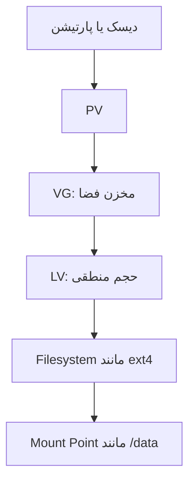
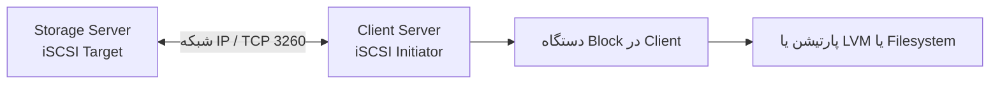
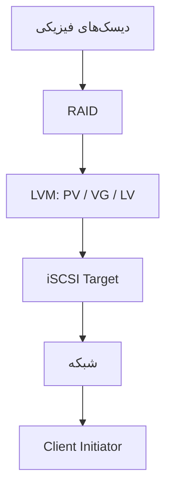

<h1 dir="rtl" align="right">راهنمای جامع RAID، LVM و iSCSI در لینوکس</h1>

<p dir="rtl" align="right">این راهنما از مبحث ****RAID**** شروع می‌شود و سپس به ****LVM**** و ****iSCSI**** می‌پردازد. هدف این است که هم مفهوم هر فناوری را یاد بگیریم و هم نمونه‌فرمان‌های عملی و نکات ایمنی را بشناسیم.</p>

<p dir="rtl" align="right"><p dir="rtl" align="right"></p>

<p dir="rtl" align="right"><em>اینفوگرافیک مروری بر RAID 0، RAID 1، RAID 5، RAID 6 و RAID 10</em></p></p>

> ****هشدار مهم:**** دستورات این آموزش را روی ماشین مجازی و دیسک‌های آزمایشی اجرا کنید. ساخت RAID، ایجاد فایل‌سیستم و پارتیشن‌بندی می‌تواند اطلاعات موجود را از بین ببرد. پیش از اجرای هر دستور، نام دیسک را با `lsblk` بررسی کنید.

<h2 dir="rtl" align="right">فهرست مطالب</h2>

1. [RAID چیست؟](#1-raid-چیست)

2. [سطوح رایج RAID](#2-سطوح-رایج-raid)

3. [پیاده‌سازی RAID 1 با mdadm](#3-پیادهسازی-raid-1-با-mdadm)

4. [پایش و مدیریت RAID](#4-پایش-و-مدیریت-raid)

5. [معرفی LVM](#5-معرفی-lvm)

6. [ساخت PV، VG و LV](#6-ساخت-pv-vg-و-lv)

7. [افزایش حجم Logical Volume](#7-افزایش-حجم-logical-volume)

8. [معرفی iSCSI](#8-معرفی-iscsi)

9. [اتصال Initiator به Target](#9-اتصال-initiator-به-target)

10. [مقایسه RAID، LVM و iSCSI](#10-مقایسه-raid-lvm-و-iscsi)

11. [تمرین پیشنهادی و چک‌لیست](#11-تمرین-پیشنهادی-و-چکلیست)

<h2 dir="rtl" align="right">1. RAID چیست؟</h2>

<p dir="rtl" align="right">RAID مخفف ****Redundant Array of Independent Disks**** است. در این فناوری چند دیسک به‌صورت یک آرایه ترکیب می‌شوند تا بسته به نوع RAID، کارایی، ظرفیت قابل‌استفاده یا تحمل خرابی دیسک بهبود پیدا کند.</p>

<p dir="rtl" align="right">RAID معمولاً در سرورها، NASها، دیتابیس‌ها و سامانه‌های ذخیره‌سازی استفاده می‌شود. RAID نرم‌افزاری لینوکس را می‌توان با ابزار `mdadm` مدیریت کرد.</p>

<p dir="rtl" align="right">****RAID نسخه پشتیبان نیست.**** RAID ممکن است از سرویس در برابر خرابی یک یا چند دیسک محافظت کند، اما جلوی حذف تصادفی فایل، باج‌افزار، خرابی فایل‌سیستم، سرقت یا از دست رفتن کل سرور را به‌تنهایی نمی‌گیرد.</p>

<h2 dir="rtl" align="right">2. سطوح رایج RAID</h2>

<p dir="rtl" align="right">ظرفیت‌های این بخش تقریبی و بر اساس دیسک‌های هم‌اندازه محاسبه شده‌اند. در عمل، ظرفیت آرایه معمولاً بر اساس کوچک‌ترین عضو تعیین می‌شود و سربارها نیز وجود دارند.</p>

| سطح | حداقل دیسک | ظرفیت تقریبی | تحمل خرابی | کاربرد و نکته |

|---|---:|---|---|---|

| RAID 0 | 2 | مجموع ظرفیت دیسک‌ها | هیچ دیسکی | سرعت و ظرفیت؛ خرابی یک دیسک ممکن است کل آرایه را از بین ببرد. |

| RAID 1 | 2 | ظرفیت یک دیسک | معمولاً یک عضو از جفت دو‌دیسکی | Mirror؛ مناسب سادگی و افزونگی. |

| RAID 5 | 3 | `(N-1) × ظرفیت کوچک‌ترین دیسک` | 1 دیسک | ظرفیت مناسب همراه با Parity؛ بازسازی ممکن است طولانی باشد. |

| RAID 6 | 4 | `(N-2) × ظرفیت کوچک‌ترین دیسک` | 2 دیسک | تحمل خرابی بیشتر از RAID 5، با هزینه ظرفیت بیشتر. |

| RAID 10 | 4 | حدود 50٪ ظرفیت خام | وابسته به محل خرابی | ترکیب Mirroring و Striping؛ معمولاً عملکرد خوبی دارد. |

<h3 dir="rtl" align="right">RAID 0 — Striping</h3>

<p dir="rtl" align="right">داده‌ها به قطعه‌هایی تقسیم و بین دیسک‌ها توزیع می‌شوند. این کار می‌تواند کارایی را افزایش دهد، اما افزونگی ایجاد نمی‌کند.</p>

<h3 dir="rtl" align="right">RAID 1 — Mirroring</h3>

<p dir="rtl" align="right">داده‌ها روی دو یا چند عضو به‌صورت کپی ذخیره می‌شوند. در RAID 1 دو‌دیسکی، اگر یکی از دیسک‌ها خراب شود، معمولاً داده‌ها از دیسک سالم قابل‌دسترسی‌اند.</p>

<h3 dir="rtl" align="right">RAID 5 و RAID 6 — Parity</h3>

<p dir="rtl" align="right">Parity اطلاعاتی برای بازسازی داده‌ها در صورت خرابی دیسک فراهم می‌کند. RAID 5 برای خرابی یک دیسک و RAID 6 برای خرابی هم‌زمان دو دیسک طراحی شده است. عملکرد نوشتن، زمان بازسازی و ریسک حین بازسازی باید در طراحی عملیاتی در نظر گرفته شوند.</p>

<h3 dir="rtl" align="right">RAID 10 — ترکیب Mirror و Stripe</h3>

<p dir="rtl" align="right">RAID 10 داده‌ها را روی جفت‌های آینه‌ای نگه می‌دارد و بین جفت‌ها توزیع می‌کند. تحمل خرابی آن به این بستگی دارد که کدام دیسک‌ها خراب شوند؛ خراب شدن هر دو عضو یک جفت می‌تواند آرایه را از کار بیندازد.</p>

<h2 dir="rtl" align="right">3. پیاده‌سازی RAID 1 با mdadm</h2>

<p dir="rtl" align="right">در این مثال فرض می‌کنیم دو ****پارتیشن خالی و اختصاصی**** به نام‌های `/dev/sdb1` و `/dev/sdc1` داریم. این نام‌ها نمونه‌اند و نباید بدون بررسی روی سیستم خودتان استفاده شوند.</p>

<h3 dir="rtl" align="right">3.1 بررسی دیسک‌ها</h3>

```bash

lsblk -o NAME,SIZE,TYPE,FSTYPE,MOUNTPOINTS

```

<p dir="rtl" align="right">اطمینان حاصل کنید که هر دو عضو، دیسک‌های آزمایشی مناسب و تقریباً هم‌اندازه هستند و داده مهمی ندارند.</p>

<h3 dir="rtl" align="right">3.2 نصب mdadm</h3>

<p dir="rtl" align="right">در Debian/Ubuntu:</p>

```bash

sudo apt update

sudo apt install mdadm

```

<p dir="rtl" align="right">در سیستم‌های Fedora/RHEL ممکن است از این فرمان استفاده شود:</p>

```bash

sudo dnf install mdadm

```

<h3 dir="rtl" align="right">3.3 ساخت آرایه RAID 1</h3>

```bash

sudo mdadm --create /dev/md0 \\

  --level=1 \\

  --raid-devices=2 \\

  /dev/sdb1 /dev/sdc1

```

<p dir="rtl" align="right">این فرمان آرایه‌ای به نام `/dev/md0` با سطح RAID 1 می‌سازد. هنگام اجرا، نام اعضا و هشدارهای ابزار را با دقت بررسی کنید.</p>

<h3 dir="rtl" align="right">3.4 مشاهده وضعیت همگام‌سازی</h3>

```bash

cat /proc/mdstat

sudo mdadm --detail /dev/md0

```

<p dir="rtl" align="right">ممکن است همگام‌سازی اولیه مدتی طول بکشد. وضعیت آرایه را تا پایان عملیات بررسی کنید.</p>

<h3 dir="rtl" align="right">3.5 ساخت فایل‌سیستم و Mount</h3>

<p dir="rtl" align="right">****این مرحله فقط برای آرایه جدید و خالی است.**** اجرای `mkfs` روی دستگاه دارای اطلاعات می‌تواند داده‌ها را از بین ببرد.</p>

```bash

sudo mkfs.ext4 /dev/md0

sudo mkdir -p /mnt/raid

sudo mount /dev/md0 /mnt/raid

df -hT /mnt/raid

```

<p dir="rtl" align="right">در این مثال فایل‌سیستم روی `/dev/md0` ساخته می‌شود، نه مستقیماً روی هر عضو RAID.</p>

<h3 dir="rtl" align="right">3.6 نکته درباره راه‌اندازی مجدد</h3>

<p dir="rtl" align="right">برای استفاده پایدار در محیط عملیاتی، علاوه بر Mount، باید پیکربندی RAID و Mount شدن فایل‌سیستم پس از راه‌اندازی مجدد به‌درستی تنظیم و آزمایش شود. روش ذخیره پیکربندی `mdadm` با توزیع لینوکس تفاوت دارد؛ مستندات همان توزیع را دنبال کنید و قبل از Restart از صحت آرایه مطمئن شوید.</p>

<h2 dir="rtl" align="right">4. پایش و مدیریت RAID</h2>

<h3 dir="rtl" align="right">مشاهده وضعیت کلی</h3>

```bash

cat /proc/mdstat

sudo mdadm --detail /dev/md0

```

<h3 dir="rtl" align="right">مشاهده اعضای آرایه</h3>

```bash

sudo mdadm --examine /dev/sdb1

sudo mdadm --examine /dev/sdc1

```

<h3 dir="rtl" align="right">نکات هنگام خرابی دیسک</h3>

1. وضعیت آرایه و پیام‌های سیستم را بررسی کنید.

2. عضو خراب را دقیق شناسایی کنید؛ بر اساس حدس `/dev/sdX` را حذف نکنید.

3. قبل از تعویض عضو، وضعیت Backup و اهمیت سرویس را در نظر بگیرید.

4. تعویض و بازسازی را مطابق مستندات `mdadm` و با توجه به وضعیت واقعی آرایه انجام دهید.

5. تا پایان Rebuild وضعیت آرایه را پایش کنید.

<p dir="rtl" align="right">فرمان‌های حذف و اضافه‌کردن عضو عمداً در این راهنمای مقدماتی به‌صورت یک دستور عمومی ارائه نشده‌اند؛ اجرای فرمان نادرست روی عضو اشتباه می‌تواند بازیابی اطلاعات را دشوار یا ناممکن کند.</p>

<h2 dir="rtl" align="right">5. معرفی LVM</h2>

<p dir="rtl" align="right">LVM مخفف ****Logical Volume Manager**** است. این فناوری فضای ذخیره‌سازی را لایه‌بندی می‌کند تا ساخت و تغییر اندازه Volumeها از پارتیشن‌بندی سنتی انعطاف‌پذیرتر باشد.</p>

<p dir="rtl" align="right">سه مفهوم اصلی LVM:</p>

- ****PV (Physical Volume):**** دیسک یا پارتیشنی که برای استفاده توسط LVM آماده شده است.

- ****VG (Volume Group):**** مخزن فضایی که از یک یا چند PV ساخته می‌شود.

- ****LV (Logical Volume):**** بخشی منطقی از فضای VG که مانند یک دستگاه Block قابل استفاده است.



<p dir="rtl" align="right">LVM به‌تنهایی RAID یا Backup نیست. اگر فضای زیرین خراب شود، نتیجه به معماری ذخیره‌سازی و افزونگی آن بستگی دارد.</p>

<h2 dir="rtl" align="right">6. ساخت PV، VG و LV</h2>

<p dir="rtl" align="right">این مثال فرض می‌کند `/dev/sdb1` پارتیشنی خالی و اختصاصی برای LVM است. اگر چنین پارتیشنی ندارید، ابتدا آن را با ابزار مناسب ایجاد کنید؛ هیچ‌گاه یک پارتیشن فعال یا حاوی داده را بدون بررسی آماده‌سازی نکنید.</p>

<h3 dir="rtl" align="right">6.1 نصب ابزار</h3>

```bash

sudo apt install lvm2

```

<h3 dir="rtl" align="right">6.2 ساخت Physical Volume</h3>

```bash

sudo pvcreate /dev/sdb1

sudo pvs

```

<h3 dir="rtl" align="right">6.3 ساخت Volume Group</h3>

```bash

sudo vgcreate vgdata /dev/sdb1

sudo vgs

```

<h3 dir="rtl" align="right">6.4 ساخت Logical Volume</h3>

```bash

sudo lvcreate -L 200G -n lvdata vgdata

sudo lvs

```

<p dir="rtl" align="right">این فرمان یک LV با اندازه ۲۰۰ گیگابایت و نام `lvdata` در VG به نام `vgdata` ایجاد می‌کند؛ VG باید فضای آزاد کافی داشته باشد.</p>

<h3 dir="rtl" align="right">6.5 ساخت فایل‌سیستم و اتصال آن</h3>

```bash

sudo mkfs.ext4 /dev/vgdata/lvdata

sudo mkdir -p /data

sudo mount /dev/vgdata/lvdata /data

df -hT /data

```

<h3 dir="rtl" align="right">فرمان‌های بررسی LVM</h3>

```bash

sudo pvs

sudo vgs

sudo lvs

lsblk

```

<h2 dir="rtl" align="right">7. افزایش حجم Logical Volume</h2>

<p dir="rtl" align="right">ابتدا فضای آزاد VG را بررسی کنید:</p>

```bash

sudo vgs

```

<p dir="rtl" align="right">اگر `vgdata` فضای آزاد کافی دارد، می‌توانید LV و فایل‌سیستم ext4 را هم‌زمان افزایش دهید:</p>

```bash

sudo lvextend -r -L +50G /dev/vgdata/lvdata

```

- `-L +50G` یعنی ۵۰ گیگابایت به حجم فعلی اضافه شود.

- `-r` تلاش می‌کند فایل‌سیستم را نیز گسترش دهد.

<p dir="rtl" align="right">سپس نتیجه را بررسی کنید:</p>

```bash

sudo lvs

df -hT /data

```

<p dir="rtl" align="right">اگر فضای آزاد VG کافی نیست و یک پارتیشن خالی دیگر مانند `/dev/sdc1` را برای افزودن به همین VG آماده کرده‌اید، می‌توان آن را به‌عنوان PV اضافه کرد:</p>

```bash

sudo pvcreate /dev/sdc1

sudo vgextend vgdata /dev/sdc1

sudo vgs

```

<p dir="rtl" align="right">این کار فضای تازه‌ای به VG اضافه می‌کند؛ سپس می‌توانید آن را به LV اختصاص دهید. نام دستگاه را با دقت بررسی کنید و فقط از پارتیشن اختصاصی و خالی استفاده کنید.</p>

<h3 dir="rtl" align="right">Snapshot در LVM</h3>

<p dir="rtl" align="right">LVM از Snapshot نیز پشتیبانی می‌کند. Snapshot می‌تواند برای برخی عملیات نگهداری یا تهیه نسخه سازگار با زمان مشخص مفید باشد، اما جایگزین Backup مستقل نیست. ظرفیت، نوع LV، میزان تغییر داده‌ها و روش بازیابی باید هنگام طراحی Snapshot در نظر گرفته شوند.</p>

<h2 dir="rtl" align="right">8. معرفی iSCSI</h2>

<p dir="rtl" align="right">iSCSI مخفف ****Internet Small Computer Systems Interface**** است. این فناوری دسترسی به ذخیره‌سازی Block را از طریق شبکه IP فراهم می‌کند؛ به‌طوری‌که سرور Client دستگاه ذخیره‌سازی ارائه‌شده را مانند یک دیسک محلی می‌بیند.</p>

<p dir="rtl" align="right">اصطلاحات اصلی:</p>

- ****Target:**** سمت سرور ذخیره‌سازی که دستگاه را ارائه می‌کند.

- ****Initiator:**** سمت Client که به Target متصل می‌شود.

- ****LUN:**** واحد منطقی ذخیره‌سازی ارائه‌شده توسط Target.

- ****IQN:**** شناسه‌ای برای Target یا Initiator.



<p dir="rtl" align="right">iSCSI به‌تنهایی RAID یا Backup نیست؛ فقط روش ارائه و دسترسی به Block Storage از طریق شبکه است. پایداری داده به ذخیره‌سازی پشت Target و طراحی کلی بستگی دارد.</p>

<h2 dir="rtl" align="right">9. اتصال Initiator به Target</h2>

<p dir="rtl" align="right">در این سناریو فرض می‌کنیم سرور Storage آدرس نمونه `192.168.10.10` دارد و Target از قبل روی آن پیکربندی شده است. آدرس و IQN زیر صرفاً نمونه هستند.</p>

<h3 dir="rtl" align="right">9.1 نصب ابزار در Client</h3>

<p dir="rtl" align="right">در Debian/Ubuntu:</p>

```bash

sudo apt update

sudo apt install open-iscsi

```

<h3 dir="rtl" align="right">9.2 کشف Targetها</h3>

```bash

sudo iscsiadm -m discovery \\

  -t sendtargets \\

  -p 192.168.10.10

```

<p dir="rtl" align="right">خروجی نمونه:</p>

```text

192.168.10.10:3260,1 iqn.2026-01.example:storage.disk1

```

<h3 dir="rtl" align="right">9.3 اتصال به Target</h3>

<p dir="rtl" align="right">IQN را با مقدار واقعی خروجی Discovery جایگزین کنید:</p>

```bash

sudo iscsiadm -m node \\

  -T iqn.2026-01.example:storage.disk1 \\

  -p 192.168.10.10:3260 \\

  --login

```

<h3 dir="rtl" align="right">9.4 بررسی Session و دستگاه جدید</h3>

```bash

sudo iscsiadm -m session

lsblk -o NAME,SIZE,TYPE,FSTYPE,MOUNTPOINTS

```

<p dir="rtl" align="right">دستگاه جدید ممکن است نامی مثل `/dev/sdb` بگیرد، اما نام آن تضمین‌شده نیست. قبل از هر تغییر، اندازه، مدل، نوع اتصال و Mount Pointها را بررسی کنید.</p>

<h3 dir="rtl" align="right">9.5 استفاده از دستگاه</h3>

<p dir="rtl" align="right">پس از شناسایی قطعی دستگاهی که Target ارائه کرده و اطمینان از خالی و اختصاصی بودن آن، می‌توان آن را پارتیشن‌بندی کرد، فایل‌سیستم ساخت یا به LVM افزود. این کارها روی دستگاهی که داده دارد می‌توانند اطلاعات را از بین ببرند.</p>

<p dir="rtl" align="right">****نکته حیاتی درباره چند Client:**** فایل‌سیستم معمولی مانند ext4 را نباید هم‌زمان از چند Client روی یک LUN به‌صورت نوشتنی Mount کرد، مگر آنکه راهکار Cluster Filesystem و مدیریت قفل مناسب به‌کار رفته باشد. دسترسی هم‌زمان نامناسب می‌تواند موجب خرابی داده شود.</p>

<h3 dir="rtl" align="right">9.6 قطع اتصال</h3>

<p dir="rtl" align="right">ابتدا فایل‌سیستم را از Mount خارج کنید و هر سرویس یا وابستگی‌ای را که از آن استفاده می‌کند متوقف کنید:</p>

```bash

sudo umount /data

```

<p dir="rtl" align="right">سپس با IQN و آدرس واقعی، Session را قطع کنید:</p>

```bash

sudo iscsiadm -m node \\

  -T iqn.2026-01.example:storage.disk1 \\

  -p 192.168.10.10:3260 \\

  --logout

```

<p dir="rtl" align="right">در محیط عملیاتی، پیش از Logout اطمینان حاصل کنید که هیچ برنامه‌ای از دستگاه استفاده نمی‌کند.</p>

<h3 dir="rtl" align="right">امنیت iSCSI</h3>

- پورت TCP `3260` را فقط برای میزبان‌های مجاز در دسترس قرار دهید.

- در صورت پشتیبانی، احراز هویت CHAP و کنترل دسترسی را پیکربندی کنید.

- در شبکه‌های حساس از طراحی امن شبکه و رمزنگاری مناسب در لایه‌های مرتبط استفاده کنید.

- تنظیمات Target، LUN و Initiator را مستند کنید و دسترسی‌ها را حداقلی نگه دارید.

<h2 dir="rtl" align="right">10. مقایسه RAID، LVM و iSCSI</h2>

| فناوری | مسئله‌ای که حل می‌کند | به‌تنهایی چه چیزی نیست؟ |

|---|---|---|

| RAID | ترکیب چند دیسک برای کارایی، ظرفیت یا تحمل خرابی | Backup نیست. |

| LVM | مدیریت انعطاف‌پذیر فضای منطقی و اندازه Volumeها | به‌تنهایی افزونگی دیسک ایجاد نمی‌کند. |

| iSCSI | ارائه Block Storage از طریق شبکه IP | به‌تنهایی RAID یا Backup نیست. |

<h3 dir="rtl" align="right">معماری ترکیبی نمونه</h3>



<p dir="rtl" align="right">این فقط یک الگوی ممکن است، نه الزام. بسته به محیط ممکن است RAID توسط کنترلر سخت‌افزاری یا خود سامانه ذخیره‌سازی فراهم شود و لایه‌های LVM و iSCSI در جای دیگری قرار گیرند.</p>

<h2 dir="rtl" align="right">11. تمرین پیشنهادی و چک‌لیست</h2>

<h3 dir="rtl" align="right">مسیر یادگیری</h3>

1. در ماشین مجازی، با `lsblk` دیسک‌های آزمایشی را شناسایی کنید.

2. یک RAID 1 آزمایشی با دو دیسک مجازی بسازید و وضعیت آن را بررسی کنید.

3. روی دستگاه آزمایشی دیگری PV، VG و LV بسازید.

4. با وجود فضای آزاد در VG، اندازه LV را افزایش دهید و نتیجه را با `df -hT` بررسی کنید.

5. دو ماشین مجازی در یک شبکه آزمایشگاهی ایجاد کنید و اتصال iSCSI را تمرین کنید.

6. پیش از اجرای سناریوی خرابی، از داده‌های آزمایشی نسخه پشتیبان بگیرید و روش بازیابی را تمرین کنید.

<h3 dir="rtl" align="right">چک‌لیست پیش از اجرای فرمان‌های ذخیره‌سازی</h3>

- [ ] نام و ظرفیت دیسک را با `lsblk` بررسی کرده‌ام.

- [ ] مطمئن شده‌ام دستگاه انتخابی حاوی داده مهم نیست.

- [ ] می‌دانم فرمان روی کدام دیسک، پارتیشن یا Volume اجرا می‌شود.

- [ ] از اطلاعات مهم Backup مستقل دارم.

- [ ] پس از تغییر، وضعیت RAID/LVM/iSCSI و فایل‌سیستم را بررسی می‌کنم.

- [ ] راه‌اندازی مجدد و بازیابی را در محیط آزمایشی امتحان می‌کنم.

<h2 dir="rtl" align="right">جمع‌بندی</h2>

- از ****RAID**** برای ترکیب دیسک‌ها و ایجاد سطح مشخصی از کارایی یا تحمل خرابی استفاده می‌شود.

- ****LVM**** مدیریت حجم‌های منطقی و افزایش ظرفیت را منعطف‌تر می‌کند.

- ****iSCSI**** فضای ذخیره‌سازی Block را از طریق شبکه در اختیار سرورهای دیگر قرار می‌دهد.

- این فناوری‌ها می‌توانند با هم کار کنند، اما هیچ‌کدام به‌تنهایی جایگزین Backup مستقل و آزموده‌شده نیستند.

<p dir="rtl" align="right">**---**</p>

<p dir="rtl" align="right">****یادداشت برای GitHub:**** این README از Markdown و Mermaid استفاده می‌کند. نمودارهای Mermaid در GitHub پشتیبانی می‌شوند. برای نمایش بهتر متن فارسی در بخش‌های توضیحی از `dir="rtl"` استفاده شده است؛ نمایش HTML ممکن است بسته به صفحه و محیط GitHub کمی متفاوت باشد.</p>
